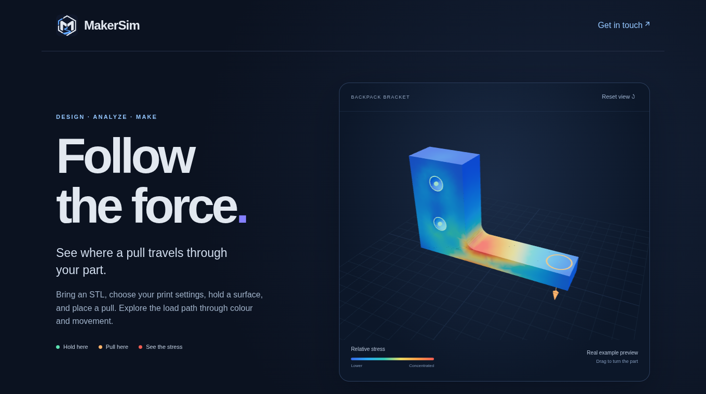
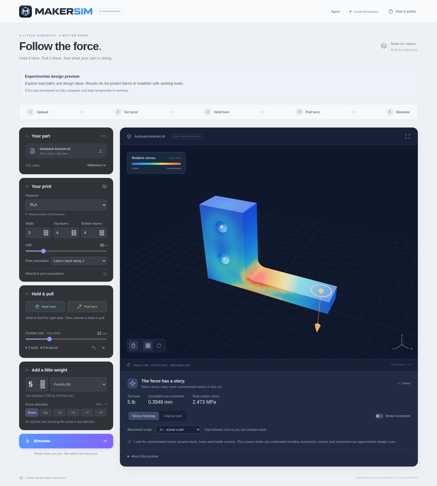
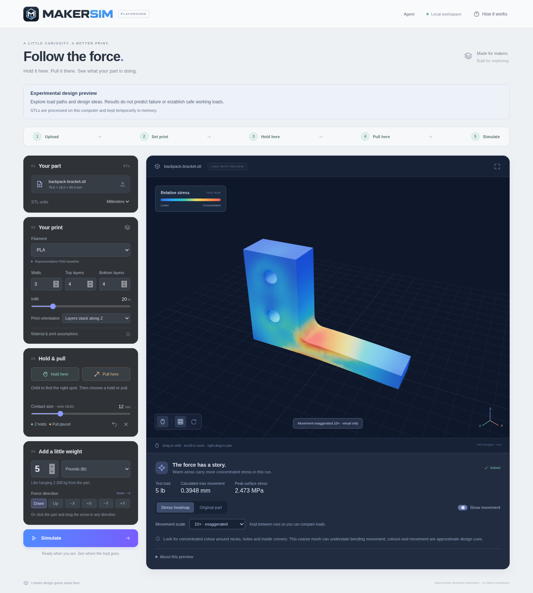
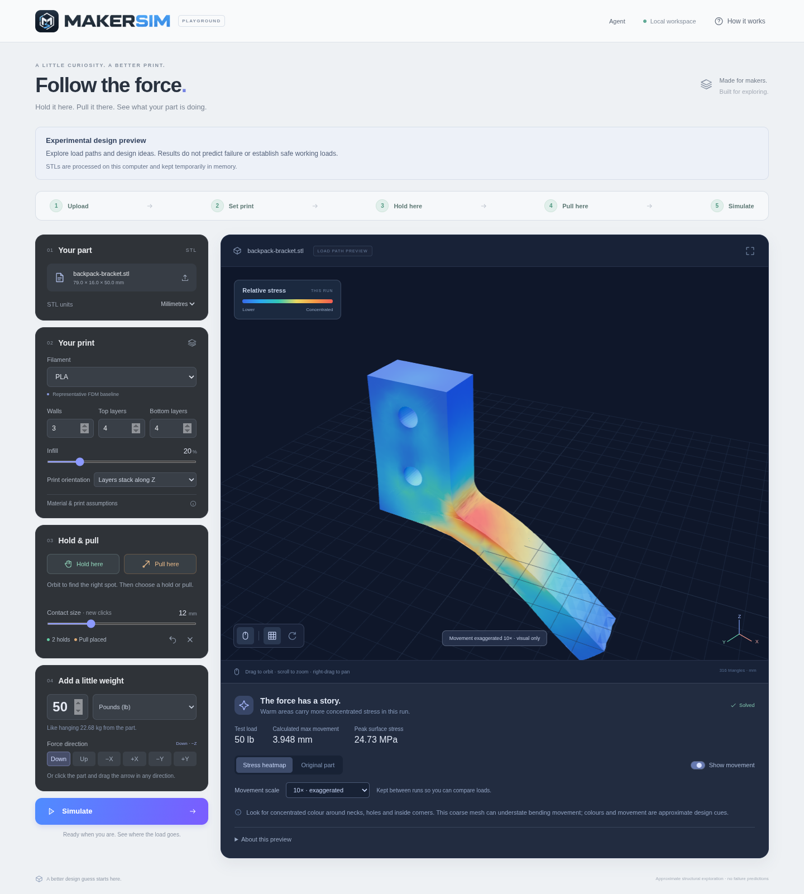
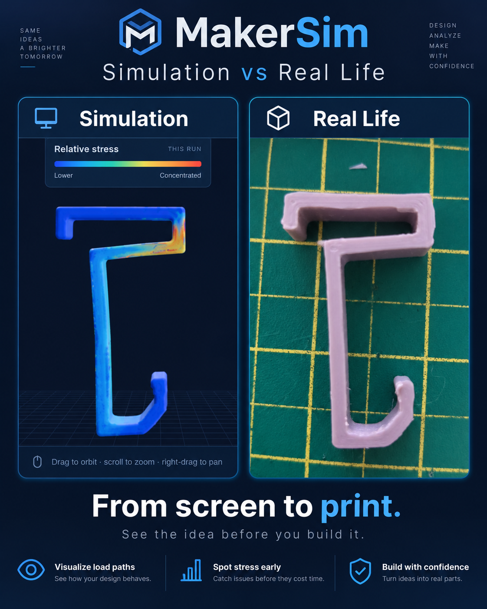
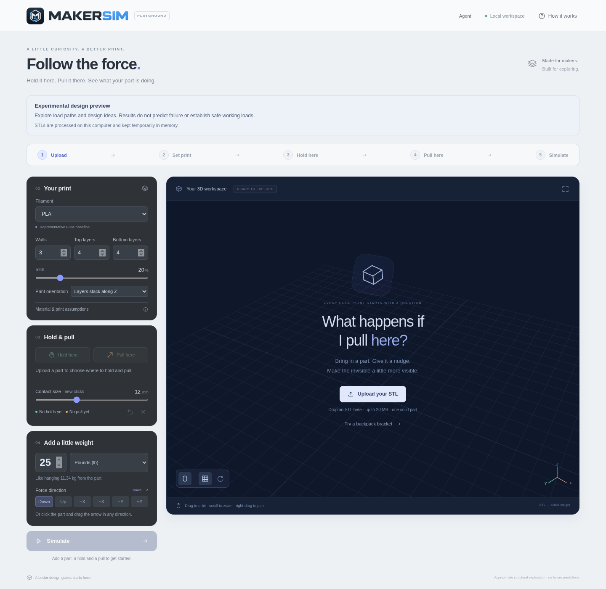
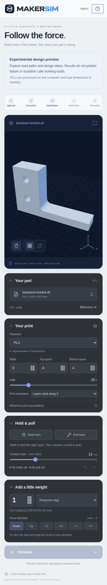

<p align="center">
  
</p>

<h1 align="center">MakerSim</h1>
<p align="center"><strong>Follow the force.</strong><br>Design · Analyze · Make</p>

<p align="center">
  
  
  
  
</p>

<p align="center">
  <a href="https://makersim.rawcastdigital.com/"><strong>Live demo</strong></a> ·
  <a href="https://makersim-playground.rawcastdigital.com/">Open the playground</a> ·
  <a href="https://shftstate.rawcastdigital.com/#contact">Request a testing session</a>
</p>

[](https://makersim.rawcastdigital.com/)

MakerSim helps makers explore how a force travels through a 3D-printed part.
Upload an STL, choose your filament and print settings, paint the surfaces held
still, and place a pull. An elasticity solver returns a relative stress
heatmap and an optional movement preview with an adjustable display scale.

The landing page stays available when the testing server is offline. Its 3D hero
uses a precomputed result from the included bracket; the playground runs your
own simulation when the server is online. You can also run MakerSim locally.

**Version 0.1.0 is an early playground checkpoint.** STL viewing, painted holds,
distributed loads, print-property assumptions, simulation, and local MCP/CLI
engineering sessions are implemented. Local sessions preserve part revisions,
agent explanations, test results, and human feedback for review and replay.
Results support design exploration; they do not predict failure or establish
safe working loads. See [physics and limits](#physics-and-limits).

## Quick start

From an installed checkout:

```bash
./scripts/start.sh
```

Open the local URL printed by the launcher. It tries **http://127.0.0.1:8000**,
then ports 8001–8010 if occupied, and finally an available system-assigned port.
To choose a port, run `./scripts/start.sh 8001`. Keep the terminal open while
working; press `Ctrl+C` to stop the app.

1. Choose **Try a backpack bracket** for a ready-to-run example, or **Upload your
   STL** in the center of the 3D workspace. After upload, file details, units, and
   replacement controls appear under **Your part** on the left.
2. Set your filament, walls, top/bottom layers, infill, and print orientation.
3. Choose **Hold here** and click or paint mounted surfaces. Choose **Pull here**
   and click a load surface, then drag the arrow or select a direction preset.
4. Set the weight or force and choose **Simulate**. Explore the heatmap, switch
   back to the original part, or enable **Show movement**. Movement starts at
   **1× actual scale**; select a larger or smaller display scale when needed.
   The chosen scale stays fixed between runs so different loads can be compared.

The included bracket starts with two mounting-hole patches held still and a
25 lb downward pull. Clear its selections to try your own setup. Use **Orbit**
to reach another side. Direction presets use the STL's axes, with Z up; the
contact-size slider applies to new clicks.

## Local AI agent interface

An agent can use MakerSim directly through the local CLI or stdio MCP server.
Both call the same solver as the app. Python 3.11+ and `uv` are sufficient for
this workflow; Node.js and a browser are only needed for the viewer.

On MCP connection, MakerSim supplies the design/test/review workflow in its
initialization instructions. `get_workflow` exposes the same guidance as a tool;
CLI agents can read it with `.venv/bin/makersim workflow`. It tells the agent to
save CAD revisions, reports and captures, present alternatives for user review,
and continue from the exact revision the user selects. The default first review
checkpoint is a baseline plus up to three useful candidates unless the user
sets another budget. User instructions take precedence. This is agent guidance,
not an enforced autonomous CAD controller; the client must pass it to the agent
and provide access to its CAD tool.

```bash
uv sync
.venv/bin/makersim schema
.venv/bin/makersim workflow
.venv/bin/makersim materials
.venv/bin/makersim inspect backend/data/backpack-bracket.stl
.venv/bin/makersim validate backend/data/bracket-test.json
.venv/bin/makersim run backend/data/backpack-bracket.stl \
  --test backend/data/bracket-test.json \
  --output .makersim/runs/bracket-r1.json --revision cad-r1
.venv/bin/makersim result .makersim/runs/bracket-r1.json --view metrics
```

[`backend/data/bracket-test.json`](backend/data/bracket-test.json) is a working
example with fixtures, print settings, 5 lb and 50 lb load cases, a tip probe,
and a 1 mm movement limit. It calculates approximately 0.395 mm and 3.948 mm
maximum movement respectively; the heavy case exceeds that numerical limit.
Use a new output filename for each run. Reports are never overwritten.

CLI operations return JSON on stdout. Successful analysis exits 0 even when
displacement criteria are `not_met`; file, validation and solver errors exit 2
with an `error.code`, message and optional details. Argument usage errors appear
on stderr. Without displacement limits the criteria are `not_assessed`.
`--fields` adds full surface positions, displacement vectors and stress values;
compact reports contain measurements, probe results, equilibrium checks,
sampled patch coverage, material provenance and validity notes.

### Connect a local MCP client

For container startup, protocol inspection, and Glama publication, see
[MCP directory publication](docs/mcp-directory.md). The root Dockerfile starts
the same local stdio server and includes its example and material data.

Use the installed `makersim-mcp` executable as a stdio server. For clients that
accept a `mcpServers` configuration:

```json
{
  "mcpServers": {
    "makersim": {
      "command": "/absolute/path/to/MakerSim/.venv/bin/makersim-mcp",
      "args": []
    }
  }
}
```

On this checkout the command is
`/home/legion/Projects/python-playground/MakerSim/.venv/bin/makersim-mcp`.
Replace the path for other machines. The server requires no HTTP listener,
browser session or AI model download. Use absolute paths in tool arguments so
the client's working directory does not affect file selection. MCP operations
return structured JSON; operation errors also set `isError: true`.

The viewer, CLI, and MCP server must use the same checkout or the same absolute
`MAKERSIM_SESSION_DIR` to share live sessions. The default is this checkout's
`.makersim/sessions/`, independent of the client's working directory. If you
override it, set the same value in the viewer's environment and the MCP client's
server configuration, for example:

```json
"env": {
  "MAKERSIM_SESSION_DIR": "/absolute/path/to/project/.makersim/sessions"
}
```

Add `env` alongside `command` and `args` in the `makersim` server entry above.

| Tool | Purpose |
| --- | --- |
| `get_workflow` | Read the automatic iteration, capture, human review and branching procedure. |
| `get_test_schema` | Discover the versioned test-file format. |
| `get_goal_schema` | Discover structured relative goals against a baseline. |
| `list_materials` | List material IDs or inspect one material's properties and sources. |
| `inspect_model` | Check STL units, original bounds and coarse-mesh readiness. |
| `validate_test` | Validate a saved specification without solving. |
| `run_test` | Solve all load cases, measure probes and optionally save a new report. |
| `get_result` | Read a saved report; `view="metrics"` omits large field arrays. |
| `query_field` | Retrieve bounded pages or spatial regions of saved surface samples. |
| `compare_runs` | Compare compatible reports, sampling fingerprints and effective stiffness changes. |
| `evaluate_goals` | Assess relative movement/stress/volume targets; optionally save an evaluation. |
| `check_convergence` | Run a bounded refinement study and report observed numerical stability. |
| `capture_result` | Render a saved full-field result into geometry, stress and movement images; return previews to the agent. |
| `create_review` | Assemble a portable visual history of revision reports with captures. |

### Live engineering sessions

In the **local** workspace, choose **Agent** to open a small, resizable floating card.
Drag its title bar to move it. The **−** button collapses it to a movable
**Engineering agent** title pill; click the pill to reopen the card. **⤢** expands
to full screen and restores the floating card when selected again. Floating
placement and size persist in this browser. With the title focused, arrow keys
also move the card or pill. Collapsing keeps the session and live events active.
Drag any edge or corner to resize the floating card. The visible bottom-right
grip works with a mouse or touch; focus it and use arrow keys to resize from the
keyboard (Shift makes larger adjustments). The card stays within the viewport,
and its size is restored after collapse, full screen, or a page refresh.
Create a session using the selected part, a copy, or a new design. Choose
Work together, Work on its own, or Show and explain, then pass the displayed session ID to
your chosen MakerSim-compatible MCP/CLI agent. Tell that agent app when to begin.
Saving a session and connecting an agent are separate from starting a run.

The session orchestrator connects the existing CAD/test workflow to live
explanations, saved geometry snapshots, simulation previews, and a replayable
timeline. CAD edits and model inference still run in the connected client.
The window does not launch an AI provider or supply a CAD engine. Selected/copy
records the intended CAD workflow; the CAD client must preserve the original
editable revision and create a copy when requested. Frequent STL exports after
individual edits make the viewport update as the design develops.

The window defaults to viewing and feedback. Questions are saved with the part,
including when no agent is connected, so a later connected agent can read them.
It names the connected agent app; no particular provider or coding client is required.
An integration must implement the shared protocol; compatibility is not implied
for every AI app. Optional execution controls appear only when a live client explicitly
declares that it honors MakerSim design-step pause/continue gates.

The activity strip stays visible above the controls: **Thinking through the
design**, **Explaining the design**, **Sketching your part**, **Simulating a load**,
**Waiting for the agent**, **Paused**, or **Ready for your review**. CAD and simulation
labels come from active steps. Text activity must be explicitly reported by the
agent using `report_design_activity`; silence never becomes a thinking indicator.
Agents refresh long activities every 30 seconds. After 60 seconds without a progress
update, the window states that progress is unconfirmed, without assuming failure or
resuming paused work. Elapsed step time and connection/reconnection state remain visible.
Agent presence is distinct from browser streaming connectivity. A named connection
refreshes every 30 seconds; after 60 seconds without evidence, execution controls hide.
Each service restart changes a viewing epoch, requiring fresh agent evidence.
Historical pause/operation records remain intact but are not presented as a live agent.
Reopening restores **Saved work**, or **Saved work · ready for review**, until a client
proves its presence. A still-running background client can reconnect by heartbeating,
without changing an existing pause or discarding its operation.
The title pill keeps a status dot and an accessible tooltip with the current activity.
History previews describe the version being viewed separately from current activity.

When optional controls are enabled, **Send and pause** and **Pause work** hold design
steps until the human explicitly resumes, either through **Continue** or their
agent app. An operation already in
progress can finish and preserve its result; new operations are blocked.
**Wait for me after each step** additionally holds after each operation or an explicit
teaching checkpoint. Mode changes and agent answers never resume a pause.
If a client disconnects during an operation, **Reset a stuck step**
invalidates that operation and leaves the session paused for review. The client
must stop its abandoned work; recovery cannot cancel an external CAD process.
Viewing-only connections save feedback without claiming to pause the external agent.
Connecting alone does not start a run. A fresh human start instruction authorizes a
new run and supersedes unfinished old leases; late results cannot overwrite its work.
Integrations relay the actual human start/resume instruction. This is a trusted-client
attestation of intent, not an independently verified human identity or approval.

The agent window stays hidden until you select **Agent** at the top. **−** collapses
it to a title pill, **×** closes it completely, and **Agent** reopens the floating card
with its saved size, position and session. Close is also available on the pill.
The card fits smaller browser windows temporarily and restores its chosen layout
when space returns; automatic fitting does not overwrite a manual resize.
The session keeps running when its window is closed, provided the connected
client continues working. **Notify when ready for review** produces an in-app
notification and updates the page title when the tab is in the background.
It does not deliver a desktop notification after the browser is closed.
Completion means **Ready for your review**; acceptance, actual fit,
manufacturing, ergonomics and physical testing remain separate.

Session state, immutable exports, test inputs and full-field reports persist in
`.makersim/sessions/` (override with `MAKERSIM_SESSION_DIR`). The local browser's
workspace cookie lasts one year, so reopening in the same browser restores
access. Clearing browser cookies removes that access; the trusted local CLI
can still read the saved session. Back up the complete directory for continuity.
Persistent sessions are disabled on the hosted public preview.

Saving a new session or selecting a saved one resets the viewport before loading
that session's own part and results. **From scratch** starts with an empty viewport;
**Copy selected part** and **Selected part** display their preserved starting part.
Previous holds, pulls and results are cleared, and late preview responses from
another session cannot restore its geometry. Earlier work stays in its saved history.

Memory stays within a project's part and branch. Matching project names never
merge context. **Try a copy from here** copies the exact timeline prefix and its artifacts
into an independent workspace, so later parent or sibling decisions cannot
bleed into it. The **What we learned** view exposes scoped memory;
corrections are additional intervention records, preserving the earlier evidence.
Lessons label their evidence as a hypothesis, simulation, human observation,
or physical test, with conditions and evidence supplied by the agent. These
labels record provenance, not independently verified truth or weight updates.

| Session MCP tool | CLI (`makersim session …`) | Purpose |
| --- | --- | --- |
| `create_design_session` | `create` | Save isolated design context; saving never starts an agent. CLI `--stl` also preserves a starting part. |
| `connect_design_agent` | `agent` | Announce an agent app by name; opt into window controls only when supported. |
| `update_design_connection` | `signal` | Refresh presence or disconnect; preserve all design history. |
| `authorize_design_run` | `authorize` | Relay the human's explicit start/resume instruction from their chosen agent app. |
| `get_design_session` | `events` | Read current state and paginated events, including interventions. |
| `recall_design_context` | `context` | Retrieve lessons and decisions from this branch's history only. |
| `publish_design_event` | `event` | Publish Plan/Do/Check/Act explanations, predictions, decisions and lessons. |
| `report_design_activity` | `activity` | Report thinking, explaining or waiting; refresh progress using the active operation ID. Never resumes work. |
| `begin_design_step` | `begin` | Acquire a checkpoint lease before one external CAD operation. |
| `finish_design_step` | `finish` | Save its outcome, editable CAD reference and exported STL preview. |
| `run_session_test` | `test` | Use the existing solver with session checkpoints and immutable artifacts. |
| `branch_design_session` | `fork` | Fork from a selected event into an isolated paused branch. |
| `complete_design_session` | `complete` | Stop and report a candidate for human review. |

The CLI also provides `get SESSION_ID` for a state-only read,
`list` for sessions not yet attached to a browser workspace, and
`control SESSION_ID ACTION` for human feedback, pause, resume, settings, or recovery.
After a browser attaches a CLI-created session, it appears in that browser's saved
sessions; trusted local agents can still access it by ID. Run
`makersim session --help` or `makersim session COMMAND --help` for arguments.

Session simulations preserve every load case; the viewport previews the first
case, identified in its notes. Saved fields and contact selections are converted
from the exported CAD coordinates to the centered viewport coordinates.
Use the existing `compare_runs`, `evaluate_goals`, `check_convergence` and review
tools on the saved report paths for comparison and numerical confidence.

Limits bound simulation attempts, elapsed operation time, and reported token
usage **between operations**. Failed simulation attempts count toward the
iteration budget. Token accounting depends on the connected agent reporting
incremental usage; it is not a hard provider spending cap. Time limits do not
kill an in-flight CAD edit or solve. Text planning time is separate. Separate paused branches can run
concurrently with separate connected clients; this milestone does not launch
or schedule multiple agent processes. Each active branch serializes its edits.
**Stop when the saved test goals are met** stops after a report assesses
all its absolute displacement criteria as met. Unassessed criteria do not stop
the session. Relative goals use the existing evaluation tools and an agent
completion decision; a free-text objective alone is not a numerical criterion.

The CLI exposes the same session operations:

```bash
.venv/bin/makersim session create --project Backpack --part Bracket \
  --objective "Show and explain a rib, then compare its movement" \
  --source copy --mode teaching --stl backend/data/backpack-bracket.stl
# Connect the returned ID in the Agent window to view this saved work.
.venv/bin/makersim session get SESSION_ID
.venv/bin/makersim session agent SESSION_ID --name "My engineering agent"
# Use its returned RUN_ID. Add --controls only for clients honoring window design-step controls.
.venv/bin/makersim session authorize SESSION_ID RUN_ID start \
  --human-instruction "Start explaining a rib on this bracket."
.venv/bin/makersim session signal SESSION_ID RUN_ID heartbeat
.venv/bin/makersim session activity SESSION_ID thinking \
  --message "Considering rib placement and room for the mounting bolts." --run-id RUN_ID
.venv/bin/makersim session event SESSION_ID prediction \
  --phase plan --message "A rib may reduce bending at this junction." --run-id RUN_ID
.venv/bin/makersim session begin SESSION_ID --description "Add one rib in CAD" --run-id RUN_ID
# For a long edit, refresh every 30 seconds with its returned operation ID:
.venv/bin/makersim session activity SESSION_ID working --operation-id OPERATION_ID \
  --message "Adding the rib; the mounting holes are unchanged." --run-id RUN_ID
# Perform the edit in the connected CAD client; preserve the editable revision.
.venv/bin/makersim session finish SESSION_ID OPERATION_ID \
  --explanation "The rib supports the loaded junction; test this hypothesis." \
  --stl /absolute/path/to/r1.stl --revision R1 --cad-reference SAVED_CAD_REVISION
.venv/bin/makersim session test SESSION_ID --test backend/data/bracket-test.json --run-id RUN_ID
.venv/bin/makersim session context SESSION_ID --query rib
.venv/bin/makersim session fork SESSION_ID --sequence SELECTED_EVENT_SEQUENCE \
  --objective "Try another rib from this saved revision"
# The new branch is paused; connect and obtain a human start instruction separately.
.venv/bin/makersim session complete SESSION_ID --run-id RUN_ID \
  --summary "Candidate ready for review; compare movement and check bolt clearance."
.venv/bin/makersim session events SESSION_ID --after 0
# Read and handle every event page; use the last returned next_after cursor.
.venv/bin/makersim session signal SESSION_ID RUN_ID disconnect --seen-sequence LAST_HANDLED_SEQUENCE
```

Local CLI session controls are for human operation. An agent must not use the
CLI to bypass a human pause. The MCP authorization relay requires an actual explicit
human instruction; agents must never generate their own approval or infer it from silence.
Clients with window controls must supply their last handled event cursor when
disconnecting. MakerSim checks for newer human inputs in the same transaction
that closes the connection, and refuses to disconnect if a direction, Continue,
or settings change arrived after that cursor. The client must handle those inputs
before retrying. This check preserves live instructions; it does not launch an
external agent app after its process has stopped.

While the human is interacting in MakerSim, clients keep polling
`get_design_session(after=LAST_HANDLED_SEQUENCE)` or
`makersim session events SESSION_ID --after LAST_HANDLED_SEQUENCE`, and heartbeat
every 30 seconds, including while paused. Read every page until no events remain;
advance with `next_after`, which can lag behind `session.sequence`. Acknowledge
and handle new questions and directions before completing or disconnecting.
Quiet agent-app chat does not mean the MakerSim conversation has ended.

Session operation errors use the same JSON error contract as other CLI/MCP tools:

| `error.code` | Client response |
| --- | --- |
| `session_paused` | Stop new operations; wait for the human's explicit start or resume. |
| `operation_active` | Finish the current operation before starting another. |
| `budget_reached` | Present saved work for review; the human can adjust limits or choose a separate copy. |
| `stale_agent` / `stale_operation` | Stop using the replaced connection or abandoned operation; read current state. |
| `input_check_required` | Read and handle session events, then provide `seen_sequence` when disconnecting. |
| `pending_input` | Handle newer human input before retrying disconnection. |

To resume from the agent app, relay its actual human instruction with
`makersim session authorize SESSION_ID RUN_ID resume --human-instruction "…"`.
When **Wait for me after each step** is enabled, do this after each held step,
or wait for the human to select **Continue** in the connected window.

### CAD → test → iterate

An agent can create or revise a part in Onshape, export its STL to a local file,
inspect the file, then run a saved MakerSim test. It can use movement, stress
concentrations and probe measurements to guide the next CAD revision. CAD export
and editing remain the CAD client's responsibility; MakerSim accepts the file.

Keep the test specification fixed across revisions. After exporting the next
STL, run it with that same test and a new report filename, then compare:

```bash
.venv/bin/makersim compare .makersim/runs/bracket-r1.json \
  .makersim/runs/bracket-r2.json
```

STL files have no unit metadata: set `stl_unit` to `mm` or `inch`. All fixture,
load and probe points and radii are **millimetres**. The default `source_mm`
coordinate frame preserves the original exported CAD axes after unit conversion;
`centered_mm` explicitly uses the browser solver's recentered frame. Inspection
and reports provide both bounds and the translation between them. Normals and
load directions follow the exported axes. Preserve the CAD origin and export
orientation across revisions; changing them requires updating the test locations.

Reports record STL and normalized-test SHA-256 hashes, an optional CAD revision,
the solver version, and material-property hashes. Comparisons reject changed
tests, material physics or solver versions. A matching test does not establish
mesh convergence: geometry changes can alter voxel sampling and contact coverage.
Read the reported patch coverage and validity notes. The small-displacement flag
uses a 2% maximum-span heuristic, not a validated applicability limit.
Calculated displacement criteria do not establish failure or safe working loads;
the existing [physics limits](#physics-and-limits) apply to agent runs too.

### Relative goals and compact queries

A goal string records intent. For numerical targets such as **at least 30% less
tip movement and at most 20% more volume**, save a separate goals file:

```json
{
  "schema_version": 1,
  "requirements": [
    {"metric": "surface_probe_max_displacement_mm", "load_case": "downward",
     "probe": "tip", "operator": "at_most", "change_percent": -30},
    {"metric": "solid_volume_mm3", "operator": "at_most", "change_percent": 20}
  ]
}
```

Use the exact case/probe names from your test. `max_displacement_mm` and
`peak_surface_stress_mpa` are also supported; `at_least` supports lower bounds
on percentage change. Run `makersim goal-schema` to discover the format.

```bash
.venv/bin/makersim evaluate baseline.json candidate.json --goals goals.json \
  --output .makersim/evaluations/candidate.json
.venv/bin/makersim result candidate.json --view metrics
.venv/bin/makersim field candidate.json --case downward \
  --field surface_stress_mpa --limit 50 --bounds 10 -12 15 35 12 40
```

Evaluation reports `met`, `not_met` or `not_assessed` separately from the test's
absolute limits and numerical confidence. A zero baseline makes percentage
change undefined and is not assessed. Percentage comparisons allow 1e-9 percentage
points for floating-point roundoff. A calculated goal can be met without mesh
convergence being verified.

`get_result` keeps its existing full-report default; use `view="metrics"` for
compact agent reads, with a field availability/count summary. `query_field`
accepts a case, field, offset, limit (1–1000), and optional `bounds_mm` as two XYZ
corners in report coordinates. CLI bounds use six values. Pages return original
surface indices, positions, values and `next_offset`; only matching nodes count
toward offsets. Queries preserve the report and do not rerun the solver.

New reports fingerprint selected coordinates to 1e-9 mm for every fixture,
load and probe, plus normalized load weights. Comparisons expose `sampling_status`
and per-selection changes, actual coverage and effective XY/build modulus and
solid-fraction changes. Identical material and print settings can still produce
different effective stiffness because the print-property approximation uses
geometry. Legacy reports remain readable; identical bounds/counts without
fingerprints give **unknown** sampling identity.

### Mesh refinement and numerical confidence

Local runs accept `--resolution` (8–100 cells along the longest dimension) and
`--max-cells` (occupied-cell budget, up to 20000). Defaults remain 28 and 4800.
Reports record requested and actual cell sizes and any budget-driven coarsening.
Use `--strict-pitch` to fail when the requested cells exceed the budget.

```bash
.venv/bin/makersim converge candidate.stl --test test.json \
  --output-dir .makersim/convergence/candidate --resolutions 28 35 44 \
  --max-cells 12000 --displacement-tolerance 5 --stress-tolerance 10
```

`check_convergence` runs 3–6 increasing resolutions with strict budgets, saving
each immutable report and `convergence.json`. It checks global displacement,
every probe and peak stress independently. `within_tolerance` requires the last
two successive changes to be within each tolerance and actual cell sizes to
decrease at every level. Otherwise it returns `not_converged`, or `not_assessed`
if actual meshes did not refine. A budget/solver failure publishes no study.
Sampling comparisons explain changes in fixture/load/probe coverage. Assess
competing designs at common mesh settings; one finer solve is not convergence
evidence. Observed mesh stability does not validate printed-material assumptions.

### Capture revisions and branch from a chosen design

Each test can automatically save four PNGs per load case: plain geometry for
aesthetic review, stress from two angles, and movement at an explicit display
scale. Rendering uses a local CPU backend, with no browser or display server.
The capture directory contains an image manifest, a full-field report copy for
later recapture, and a standalone `index.html` with embedded images.

```bash
.venv/bin/makersim run part-r4.stl --test test.json \
  --output .makersim/runs/r4.json --revision R4 \
  --images .makersim/captures/r4 --stress-max 1 --movement-scale 100 \
  --branch stiffness --goal "Reduce movement within the volume budget"
```

Choose a common `--stress-max` in **MPa** for the revision series. Without it,
each report uses its own largest surface stress for the legend; those colors
cannot compare magnitudes across reports. Movement defaults to 1× actual scale;
use the same explicit multiplier for comparison images. Images label the
physical movement separately from its display multiplier. The stress pictures
show interpolated surface von Mises concentration, not stress-direction flow
lines or failure predictions. They are saved renders, not desktop screenshots.

For an existing report saved with `--fields`:

```bash
.venv/bin/makersim capture .makersim/runs/r4.json \
  --output-dir .makersim/captures/r4 --stress-max 1 --movement-scale 100
```

Captures use tighter framing and orthographic projection by default. Set
`--elevation`, `--azimuth`, `--zoom` (0.5–2), or `--projection persp` on `run` or
`capture`. Camera settings are saved in the manifest. Add underside/detail views:

```bash
.venv/bin/makersim capture .makersim/runs/r4.json \
  --output-dir .makersim/captures/r4-details --stress-max 1 \
  --elevation 30 --azimuth -120 --zoom 1.2 \
  --views geometry geometry_underside stress_underside stress_detail \
  --detail-bounds 10 -12 15 35 12 40
```

MCP accepts `camera={"elevation":30,"azimuth":-120,"zoom":1.2}`, `views`,
and `detail_bounds_mm=[[10,-12,15],[35,12,40]]`. Detail views crop to that region
in report coordinates. Default captures still contain four views per load case.

The original report is preserved; the new capture bundle has its own
`report.json`. If the STL has moved, use `--stl`; its hash must match the saved
revision. Compact reports without fields need a new run with `--images`.

Review geometry and behavior together, then choose any revision as the parent
of a new branch. For example, if R4 looks better for its intended use than R7:

```bash
.venv/bin/makersim review .makersim/runs/r4.json .makersim/runs/r7.json \
  --output .makersim/revision-review.html
.venv/bin/makersim run part-r4-a1.stl --test appearance-test.json \
  --output .makersim/runs/r4-a1.json --revision R4-A1 \
  --parent-report .makersim/runs/r4.json --branch appearance \
  --goal "Improve appearance while retaining acceptable stiffness" \
  --images .makersim/captures/r4-a1 --stress-max 1 --movement-scale 100
```

The review command accepts reports containing captures, including a capture
bundle's `report.json`. Two revision selectors let you inspect any pair side by
side. It embeds its PNGs so the HTML can be shared independently
and flags differing stress legend scales. MCP capture operations return geometry
and stress images directly as well as file paths, allowing an agent with vision
to inspect what it created.

Parent references record the saved report hash, CAD revision, STL hash and test
hash. Existing revisions and captures are never overwritten. Branch labels and
goal text document design intent; they do not select the preferred design or
change numerical criteria. Set numerical limits in the test specification. If
test conditions or limits change, rerun the chosen parent's STL with the new
test as the branch baseline, then compare its children under that same test.

## Installation

The source launcher uses Bash, Python 3.11+, Node.js 20.19+, npm, and
[uv](https://docs.astral.sh/uv/). A browser with WebGL is required for the viewer.

```bash
git clone https://github.com/RawLabs/MakerSim.git
cd MakerSim
uv sync
./scripts/start.sh
```

The launcher installs Python dependencies with `uv` when needed, installs the
frontend dependencies when absent, builds the frontend, and serves the workspace
and solver from one local Python process. Existing services on other ports are
left running. The source launcher is intended for Linux and other environments
with Bash; a native Windows launcher is not included.

The local launcher runs on `127.0.0.1`. Uploaded parts stay in the local process.
Each browser retains its last two uploads, within a six-model server budget;
models expire after two hours and disappear when the process stops. Dependencies
need internet access for their initial installation; Three.js is bundled locally.
Geometry explicitly saved in an engineering session and its test reports persist
across restarts in the session directory described above.

### Hosted playground

Visit [makersim.rawcastdigital.com](https://makersim.rawcastdigital.com/) for the
live demo and server availability. If the server is offline, 
[request a testing session through ShftState](https://shftstate.rawcastdigital.com/#contact).

There is no account or database. A random HTTP-only browser cookie identifies
each temporary workspace; another workspace cannot solve or evict its parts.
Persistent engineering sessions and their browser controls are local-only;
the hosted preview does not expose `/api/sessions`.
Visitors should use non-sensitive designs. Multipart parsing can use temporary
files; models and results are not saved as permanent documents. Hosted parts
expire after 15 minutes and a one-minute cleanup removes expired models from
memory. The trial admits twelve models globally and two per workspace, within a
shared 192 MiB surface-mesh budget. Two upload requests can be received at once;
dense STL processing and simulation share a single processing gate. Uploads are
at most 64 MB and 1,000,000 triangles; request bodies, mesh sizes, and requests
per client are bounded.

## Demo screens

Captured from the actual application with the real local solver. The example
geometry and loading are a demonstration, not a validated bracket design.

### Load-path preview



Warm colors identify concentrated stress within this run. Colors rescale with
each simulation and are not a failure scale.

<details>
<summary>Compare 5 lb and 50 lb at the same movement scale</summary>

The same bracket and test settings calculate 0.3948 mm maximum movement at
5 lb and 3.948 mm at 50 lb. Both previews use **10× exaggerated movement**, so
the tenfold load increase remains visible at a fixed display scale.





</details>

### Small hook: simulation and real life

<p align="center">
  
</p>

The physical hook retained a bend after holding a sweater and a pair of pants
overnight. Its material was believed to be PETG; the load was not weighed, and
the hook was subsequently heated in an attempt to reshape it. This is a
qualitative comparison, not a controlled validation. MakerSim shows an elastic
response with exaggerated movement; it does not model creep, temperature effects,
or permanent deformation over time.

<details>
<summary>Start a new part — center upload prompt</summary>



</details>

<details>
<summary>Mobile workspace</summary>

<p align="center">
  
</p>

</details>

[Quick start](#quick-start) · [Physics and limits](#physics-and-limits) ·
[Verification](#verification) · [Logo and brand sheet](artifacts/MakerSimLogos.png)

## Current playground workflows

| In the workspace | What MakerSim helps you do |
| --- | --- |
| **Your part** | Load binary or ASCII STLs, check dimensions and units, and replace the part. |
| **Your print** | Choose filament, walls, solid layers, infill, and the build axis. |
| **Hold & pull** | Paint several held areas and place a distributed load patch with a draggable arrow. |
| **Add a little weight** | Enter pounds or kilograms of hanging weight, with a familiar weight equivalent. Stone and newtons remain available. |
| **Simulation detail** | Choose Standard for a faster preview or Fine for smaller solver cells; inspect the actual mesh size under About this preview. |
| **Simulate** | Read the test load in your chosen unit, calculated maximum movement and peak surface stress; explore relative stress and movement at a fixed, adjustable display scale. |

The viewer supports orbit, zoom, pan, camera fit, grid visibility, and optional
slow rotation. Changing material, print settings, holds, direction, load, or
simulation detail clears the previous result so the displayed preview matches
the current setup.
Changing only the load unit converts the displayed amount and preserves the same
physical load and solved result. The browser remembers the selected unit across
reloads, agent updates and history replay. With no saved preference, agent previews
use the saved test's weight unit, or pounds when a test uses newtons.

STLs do not declare their units. MakerSim defaults to millimetres; choose inches
when appropriate and check the displayed dimensions. Files can contain up to
64 MB and 1,000,000 triangles in the browser, local CLI, and MCP. Binary STL
is preferable for dense exports because it is smaller than ASCII. Open surfaces
can be viewed but must be repaired before solving. Simulation requires one
connected, closed solid with consistent triangle winding. Inconsistent triangle
directions produce a repair message
before they can affect the print-property estimate. A hollow solid may have
separate closed surfaces around enclosed cavities; those are accepted after
containment checks. Disconnected solids, overlapping cavities, and touching
or crossing cavity surfaces remain rejected.

### Contact areas and mesh comparisons

**Contact size** is the diameter of the patch created by a new hold or pull click.
Changing the slider does not resize existing patches. Use **Undo last hold** or
**Clear held and pull areas** to replace holds; click again with **Pull here** to
replace the load patch. The hold count is the number of painted patches, not the
number of fasteners. Each green dot marks a patch centre.

Turn off **Show movement** and select **Original part** to inspect the painted
hold areas and load marker. For an idealized screw mounting, place holds around
the actual restrained contact areas, such as the screw heads or washers. Large
patches can hold much of the base rigidly and strongly affect calculated movement
and stress. Match the mounting assumptions to the intended setup; smaller patches
are not automatically more accurate. MakerSim does not model bolt preload or
contact between the part and its mounting surface.

Place the pull where the load actually bears on the part. Check its arrow against
the part's mounted orientation: **Back** means +Y and **Down** means −Z in model
coordinates. Orbiting the camera does not change these directions.

To compare mesh detail, solve once in **Standard**, then select **Fine** and rerun
with the same geometry, material, print settings, holds, pull, and force. Compare
the displayed movement, peak stress, and actual cell size under **About this
preview**. Changing patch sizes between runs changes the test itself. A noticeable
change between Standard and Fine means resolution still affects the result; two
levels alone do not establish mesh convergence. Compare numerical values as well
as colors, because each heatmap uses its own relative scale.

## Physics and limits

The solver classifies the closed STL with triangle scanlines, builds a bounded
voxel volume, and divides each cell into six conforming
linear tetrahedra. If coarse sampling splits a connected part or misses its
thickness, meshing retries with smaller cells within the same budget. Actual
separate solids remain rejected; meshing does not fill gaps or discard pieces.

The browser's **Simulation detail** control selects Standard (28 target cells
along the longest dimension, up to 4,800 occupied cells) or Fine (40 target
cells, up to 8,000 occupied cells / 48,000 tetrahedra). Fine takes longer and
uses more memory. The result reports actual cell size and explains when the
budget required coarser cells. STL surface triangle count is independent of
solver resolution; a denser export alone does not refine the calculation.
For local CLI/MCP runs, the equivalent Fine settings are `resolution=40` and
`max_cells=8000`; explicit refinement and convergence tools remain available.
Finer meshes still require convergence checks before trusting numerical detail.

The model assembles a three-dimensional orthotropic elasticity matrix in
**mm, N, MPa** and solves free degrees of freedom with SciPy. Held patches
constrain all three translations. Load clicks expand to at least a mesh-cell
surface patch and distribute the total force over several surface nodes.
Overlapping holds/loads, floating pieces, incomplete rigid-body constraints,
and excessive equilibrium residuals produce actionable errors.

Surface stress is a volume-weighted nodal von Mises scalar used to visualize
concentration, not an anisotropic failure criterion. The frontend interpolates
the field onto a subdivided version of the original STL. Each run rescales
colors using its 98th percentile, so colors alone cannot compare load magnitudes
across runs. Test load (in the chosen display unit), calculated maximum movement (mm), and peak surface
stress (MPa) are displayed separately. Movement defaults to actual scale (1×),
with explicit reduction or exaggeration options from 0.001× to 10,000×. The
chosen display scale stays fixed across reruns, so increasing a load tenfold
produces tenfold displayed movement under the same material and constraints.
Replacing the part resets the display scale to 1×. These are linear-elastic
calculations; large movements do not predict the real deformed shape.

### Mesh approximation

This is a staircase volume approximation rather than a boundary-conforming
tetrahedral mesh. Features smaller than roughly two cells can disappear; small
bolt holes and thin walls need particular care. There is no mesh-convergence
guarantee, and first-order tetrahedra can be overly stiff in bending. Selected
contact areas also approximate the coarse volume. A part whose connections
cannot be resolved within the mesh budget needs thicker features or simpler
geometry for this preview.

One default-mesh cantilever benchmark understated bending movement by about 23%
against its beam-theory reference using the meshed dimensions. Error varies with
geometry; this is not a correction factor for other parts.

### Print assumptions

Print settings use a heuristic effective solid fraction from walls, solid layers,
and infill. V1 assumes 0.45 mm extrusion width, 0.20 mm layers, and balanced
in-plane rasters. A symmetric positive definite compliance model uses separate
XY/Z moduli and in-plane shear stiffness; build-axis shear is estimated.

The build direction can be X, Y, or Z. Arbitrary rotations, explicit rasters,
individual strands, slicer toolpaths, and delamination are not modeled. Flexible
materials and large movements are especially approximate. There are no failure
predictions, certified loads, yield/plasticity, creep, temperature effects,
contact, buckling, impact, or large-deformation analysis.

## Material sources and provenance

[`backend/data/materials.json`](backend/data/materials.json) and
[`makersim_filament_master.csv`](backend/data/makersim_filament_master.csv) are
preserved from the T7 MakerSim archive without importing its architecture.
[`backend/materials.py`](backend/materials.py) maps catalog entries into a small
physics schema with explicit XY/Z Young’s modulus, XY shear modulus, Poisson
ratio, density, and optional directional strengths. The solver uses stiffness,
not strength thresholds.

The 12 generic FDM baselines in
[`fdm_baselines.json`](backend/data/fdm_baselines.json) are adapted from
[ichris97/multimaterial-3d-printing](https://github.com/ichris97/multimaterial-3d-printing/blob/master/src/multimaterial_3d/core/materials.py),
file SHA `91a9e899c542041058a8ba835b2256e969720563`. They represent well-tuned,
solid prints rather than verified product measurements. The upstream MIT notice
is retained in [`BASELINE_LICENSE`](backend/data/BASELINE_LICENSE). Its CLT,
post-processing, failure estimates, and geometry-only stress maps are not imported.
Raster and geometry-precheck ideas remain deferred.

Unsupported archive entries remain visible but cannot be simulated when usable
stiffness is absent or continuous reinforcement exceeds this model. Missing Z
stiffness and shear are labeled assumptions; missing tensile strength is not
manufactured. Archived values have not been reverified against current datasheets.
Future measurements should override individual fields with their source and
print conditions.

External catalogs and printed-test corrections are separate future inputs.
References include [Open Filament Database](https://api.openfilamentdatabase.org/),
[OpenPrintTag](https://github.com/OpenPrintTag/openprinttag-database),
[FilamentCat](https://filamentcat.com/en), and
[3DPIceland](https://www.iskort.is/3dp/). V1 does not automatically ingest them:
identity matching, permitted reuse, units, test conditions, and field provenance
need a deliberate adapter.

## Development

Run the backend with reload enabled:

```bash
uv sync
.venv/bin/python -m uvicorn backend.app:app --reload --host 127.0.0.1 --port 8000
```

In another terminal, run the Vite frontend:

```bash
cd frontend
npm install
npm run dev
```

The frontend opens at **http://127.0.0.1:5173** and proxies `/api` to Python.

| Path | Contents |
| --- | --- |
| `backend/` | Local CLI/MCP, persistent session store and API, local and hosted API, STL parsing, material adapter, and elasticity solver. |
| `backend/data/` | Example STL, archived materials, generic baselines, and their license. |
| `frontend/` | Vite workspace, floating agent window, session replay, viewer, and bundled Three.js. |
| `deploy/` | Static landing page, 3D hero sources, and isolated VM deployment files. |
| `scripts/` | Launcher, checks, example generation, and browser QA transport. |
| `tests/` | Solver, API, CLI/MCP, session persistence and controls, launcher, and viewer interaction checks. |
| `artifacts/` | Brand sheet, landing hero, application screenshots, and the real-life hook comparison poster. |

## Verification

From the repository root:

```bash
./scripts/check.sh
```

This runs the Python suite, real Three.js interaction checks integrated with
solver output, session display/activity and load-unit checks, and the production
build. The Python suite includes affine
tetrahedral strain, an analytical axial bar, equilibrium,
tenfold-load scaling, orientation, print settings, retained holes, patch spreading,
thin-feature refinement, enclosed cavities, shell containment and intersection,
mesh-budget limits, mixed winding, extreme direction
vectors, nonfinite JSON validation, atomic model storage, browser workspace
isolation, streamed body limits, hosted rate limits, and upload concurrency.
Local agent checks cover CAD coordinate preservation, multi-load and probe
measurements, artifact preservation, report compatibility, CLI execution outside
the checkout, local PNG capture and review, branch lineage, and a real MCP
client/server exchange over stdio, including image previews.
Session checks cover durable state, paginated events, scoped memory and branches,
immutable geometry/test/report artifacts, pause/resume gates, abandoned leases,
budgets, named agent presence, restart recovery, pending-input disconnection
checks, browser ownership, and hosted session exclusion.

In-process HTTP tests run worker functions inline because the restricted build
environment blocks cross-thread wakeup sockets; those tests do not verify worker
concurrency. The stdio MCP test uses a real subprocess and requires worker wakeup
sockets; run the checks in an environment that permits them. The Node interaction
checks exercise actual geometry and raycasting
without WebGL.

For browser verification with Playwright and Chromium installed:

```bash
MAKERSIM_CHROMIUM=/usr/bin/chromium node scripts/browser-smoke.mjs
```

`MAKERSIM_PLAYWRIGHT_MODULE` can point to an existing Playwright module. The
harness serves built files through browser request interception and connects to
the real API in-process. It checks center upload, left-side replacement, painted
holds, arrow dragging, solving, reruns, unit conversion, help, movement, and mobile
layout. Full WebGL browser checks pass. Chromium needs socket access and may need
to run outside a restrictive sandbox. This intercepted harness does not verify
a live localhost deployment.

The offline revision review has its own optional browser check:

```bash
node scripts/review-smoke.mjs .makersim/revision-review.html
```

Use the same `MAKERSIM_PLAYWRIGHT_MODULE` and `MAKERSIM_CHROMIUM` overrides when
needed. An optional second argument saves a screenshot of the comparison.

The live session browser check starts a temporary localhost server and exercises
real SSE, saved-work reopening, named agent connections, optional Pause/Continue,
agent-app start/resume, server shutdown/reconnection, saved questions, new-session
viewport resets, cancellation of old previews, selected-part baselines, window
resizing, simulation fields, load units, replay, branching, completion
notification and mobile layout:

```bash
node scripts/session-smoke.mjs
```

Use the same Playwright and Chromium overrides. `MAKERSIM_QA_ARTIFACTS` selects
a directory for desktop/mobile screenshots; all session data is temporary.

## License and third-party notices

MakerSim's original software and documentation are licensed under the
[MIT License](LICENSE), copyright 2026 RawLabs. The supplied logo and artwork
are excluded from that grant and are not granted a separate reuse license by
this repository.

Bundled third-party components retain their own licenses:

- Three.js r180 is vendored from the
  [official Three.js repository](https://github.com/mrdoob/three.js/tree/r180),
  with its [MIT license](frontend/src/vendor/LICENSE) retained locally.
- The generic FDM baselines retain their upstream
  [MIT notice](backend/data/BASELINE_LICENSE).

The original [logo and brand sheet](artifacts/MakerSimLogos.png) is included
alongside the screenshots and supplies the application header artwork.
