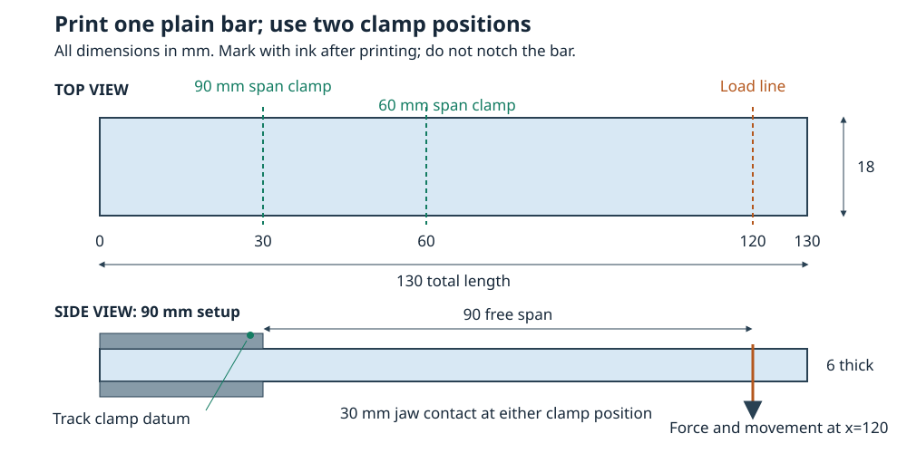

# A small bending test with a luggage scale

Print three plain **130 × 18 × 6 mm** bars and measure their bending at **60 mm and 90 mm free spans**. This kit compares measured compliance (millimetres per newton) with MakerSim. It can reveal fixture movement, print variability and time-dependent deformation. It does not measure breaking strength or establish a safe working load.

The supplied starting profile is generic PLA, flat on the 130 × 18 mm face, 100% infill, 3 walls, 5 top and 5 bottom layers, 0.20 mm layers and 0.45 mm extrusion width, with alternating ±45° raster relative to the long axis. These are explicit starting assumptions, not calibrated properties for your printer or filament. Keep the settings identical across the three coupons. An additional untouched coupon or a different geometry will be needed later to validate any fitted adjustment independently.

## Print and mark the coupon

Print [coupon-130x18x6.stl](../backend/data/calibration/coupon-130x18x6.stl) at 100% scale in millimetres. The shorter `beam-span-*.stl` files are simulation domains; print the full 130 mm coupon for the physical test. The bar has no holes, engraved marks or notches. Add ink marks after printing at **x = 30, 60 and 120 mm**, measured from the same end.



| Setup | Clamp exit | Load line | Free span | Jaw contact region |
| --- | ---: | ---: | ---: | --- |
| Longer span | x = 30 mm | x = 120 mm | 90 mm | x = 0–30 mm |
| Shorter span | x = 60 mm | x = 120 mm | 60 mm | x = 30–60 mm |

The last 10 mm is an unloaded tail. **Measure movement at x = 120 mm, not at the tip x = 130 mm.** Reposition the clamp so its actual gripping length remains 30 mm in both setups. Use a rigid bench and stiff, flat jaws; a flexible printed clamp would add another unknown. Keep the jaw edge square to the beam, grip evenly without crushing the print, and mark both coupon and jaw so slip is visible. Record the actual distance from the jaw exit to the centre of the loading strap.

Use a narrow soft strap across the width at the load line, centred on the bar. Pull vertically downward through the scale, keeping the resultant in the middle of the width. A hook pressed into one corner introduces local damage and twist. Record the strap width and its position. The simulation approximates its far-field resultant with a uniform vertical traction on the complete end section; contact near the real strap is not reproduced.

Label the coupons A, B and C. Record printer, nozzle diameter, filament brand/colour/lot, drying, slicer version/profile, temperature, cooling, speeds, actual wall and layer counts, infill pattern/angle, and print date/batch. Let all samples reach the same room conditions; using at least 24 hours after printing is this kit's consistency rule, not a standards claim. Keep them away from a warm bed, sunlight or a heater during measurement. Record room temperature and any conditioning differences.

Measure width and thickness at three places along the free region, gently with a caliper, before loading. Keep those readings in the notes and enter representative measured dimensions in the CSV. A thickness error matters strongly: in ideal rectangular-beam bending, compliance varies as the inverse of thickness cubed. A 1% thickness error can therefore look like roughly a 3% modulus error. Investigate warped or visibly defective coupons separately rather than quietly pooling them with the others.

## Measure force and movement together

A luggage scale usually displays a mass-equivalent reading. Convert **kg × 9.80665 to N**, or **lb × 4.448221615 to N**. The CSV parser can do this: enter `scale_reading` and `scale_unit` (`kg`, `lb`, `lbf` or `N`) and leave `force_n` blank. If both are supplied, they must agree to rounding precision. Never enter a kilogram reading directly in the newton column.

Record the scale's smallest displayed increment and its stated accuracy separately. For example, a 0.1 kg increment corresponds to 0.980665 N; it does not guarantee accuracy within that amount. Check repeatability with several known masses in the range you will use. Read the current force, not a stored peak. If the scale only shows an earlier peak, it cannot supply simultaneous steady-force measurements for this protocol. Account for strap, hook or scale-body weight that loads the coupon but is outside the scale's measured force path. A preload must be recorded, not silently tared away.

Measure vertical movement at the ink mark on the **load line**, relative to a datum on the clamping fixture. A fixed camera viewing a fine ruler in the same plane can work if its reading uncertainty is demonstrated; a suitable indicator is another option, provided its contact force is small enough. Do not push a hand-held caliper against the loaded bar. Keep the camera square to the measurement plane to reduce parallax, and record force and displacement in the same video or at the same instant.

Track the jaw datum as well as the coupon mark, and subtract fixture translation. Two separated marks on the jaw help reveal rotation. A single moving datum cannot remove rotation of a flexible clamp. Independent specimen-deflection measurement is valuable because motion of a testing frame or fixture can otherwise contaminate a flexural modulus estimate. [Instron's ASTM D790 guide](https://www.instron.com/en/testing-solutions/astm-standards/the-definitive-guide-to-astm-d790/)

Set positive `deflection_mm` downward, from the unloaded baseline. Do not reset that baseline between load steps or before recording recovery. Keep a nonzero baseline force if a harness preload is present; the fitted line includes an intercept, so it does not force every experiment through an artificial zero.

## Run small, repeatable cycles

Start gently with the shorter span. Suggested force targets are **0, 4, 8, 12 and 16 N** for 60 mm, and **0, 2, 4, 6 and 8 N** for 90 mm. They are planning points, not allowable loads. Record the actual readings rather than replacing them with the target values.

Stop increasing force if the load-line displacement exceeds **2% of the free span** (1.2 mm at 60 mm, 1.8 mm at 90 mm), or if you see slip, whitening, cracks, a sudden change in response or persistent bending after unloading. This matches the solver's initial small-displacement screen for these beams; it is not a guarantee against damage. If usable force/deflection ranges remain too small for the instruments, improve the measurement method instead of forcing the coupon to a higher load.

1. Record the unloaded baseline, clamp position, dimensions and temperature. Apply force smoothly over about five seconds; do not jerk the strap.
2. At each target, hold as steadily as possible. Record simultaneous force and deflection after 10 seconds, with `phase=loading` and the actual `hold_seconds`. Use the same ramp and hold timing throughout.
3. Unload through the same levels and record the same quantities at the same hold time with `phase=unloading`. Keep these observations separate from the loading fit.
4. At zero applied force, record recovery after 10, 60 and 300 seconds with `phase=recovery`. Leave the displacement baseline unchanged. Residual motion can indicate slip, time-dependent recovery or damage; inspect before repeating.
5. Repeat up to three gentle cycles, then change span and repeat. Repeat both setups on all three coupons. Alternate the order of spans across coupons where practical and record the order, so prior loading is visible in the data. Stop a coupon that develops an irreversible change.

At one moderate force already shown to be repeatable, also record a short hold at 10 and 60 seconds with `phase=hold`. Start `hold_seconds` at zero when that plateau is reached. Use a separate row for each reading and keep rows in time order. A time reset or an intervening non-hold row starts a new plateau. If force drifts, the observed displacement change cannot simply be labelled creep. A stable hanging mass with the scale inline may be easier to hold than a hand pull; include all transmitted weight. Do not leave a loaded test unattended.

These short holds screen time dependence only. Standard creep testing treats sustained load and controlled environment explicitly; a one-minute observation cannot establish long-term creep or rupture performance. [ASTM D2990](https://store.astm.org/standards/d2990)

For a fit, collect at least **four resolved loading-force levels**, with total force and deflection ranges each at least **five instrument increments**. This is a minimum data-quality screen, not a metrology standard. For example, an ordinary 1 mm ruler will usually be inadequate here. Resolution, force accuracy, alignment, timing and fixture stability all remain relevant after the screen passes.

## Record and compare

Create a fresh working copy from the repository root. The generator refuses to overwrite a directory, protecting recorded measurements.

```bash
rtk .venv/bin/python -m scripts.make_calibration_coupon --output-dir /tmp/my-coupon-kit
```

Keep a permanent copy somewhere appropriate before removing temporary files. The kit includes the printable STL, two analysis STLs, test specifications, an empty `measurements.csv`, `correlation-setup.json`, a drawing and a hash manifest. No physical measurements are prefilled.

The CSV columns are:

```text
coupon_id,span_mm,cycle,phase,force_n,deflection_mm,hold_seconds,width_mm,thickness_mm,temperature_c,scale_reading,scale_unit,notes
```

Use one row per observation, coupon IDs that identify physical specimens, positive integer cycles, and one of `loading`, `unloading`, `hold`, `recovery`. `span_mm` identifies the matching simulation reference. The supplied references represent exactly 60 and 90 mm; if the measured free span differs, reposition the fixture accurately or create a matching simulation and reference entry. Preserve raw scale readings and note re-clamping, preload, temperature changes, slip or irregular behaviour. Repeated cycles on A remain one physical specimen, not three independent samples.

In `correlation-setup.json`, fill in the **actual** `force_resolution_n` and `displacement_resolution_mm`; they deliberately start as `null`. Add the print, instrument and fixture details to `metadata`. Report paths are relative to that setup file. Measured width and thickness are retained and compared with reference dimensions; the analysis flags differences but does not silently correct geometry or convert them into a material adjustment.

Generate reference results with the same nominal 1 mm cell pitch for both spans:

```bash
rtk .venv/bin/makersim run /tmp/my-coupon-kit/beam-span-60.stl --test /tmp/my-coupon-kit/test-span-60.json --resolution 60 --max-cells 20000 --strict-pitch --fields --output /tmp/my-coupon-kit/reference-span-60.json
rtk .venv/bin/makersim run /tmp/my-coupon-kit/beam-span-90.stl --test /tmp/my-coupon-kit/test-span-90.json --resolution 90 --max-cells 20000 --strict-pitch --fields --output /tmp/my-coupon-kit/reference-span-90.json
```

Before treating a physical discrepancy as a material discrepancy, examine mesh refinement at matching 2, 1.5 and 1 mm pitches:

```bash
rtk .venv/bin/makersim converge /tmp/my-coupon-kit/beam-span-60.stl --test /tmp/my-coupon-kit/test-span-60.json --resolutions 30 40 60 --max-cells 20000 --output-dir /tmp/my-coupon-kit/convergence-60
rtk .venv/bin/makersim converge /tmp/my-coupon-kit/beam-span-90.stl --test /tmp/my-coupon-kit/test-span-90.json --resolutions 45 60 90 --max-cells 20000 --output-dir /tmp/my-coupon-kit/convergence-90
```

Inspect movement at the `load_line` probe across refinements. The comparison is the **mean displacement projected along the force direction**, divided by the reference force. With this kit's downward 1 N load it equals `-mean_displacement_vector_mm[2]` in mm/N. Whole-part maximum displacement, vector magnitude and movement of the physical 10 mm tail are different observables. The supplied model has an ideal fixed left end; it does not simulate clamp slip or fixture rotation. Passing a numerical refinement tolerance alone does not validate those physical assumptions.

After recording measurements and filling the setup:

```bash
rtk .venv/bin/makersim correlate /tmp/my-coupon-kit/correlation-setup.json /tmp/my-coupon-kit/measurements.csv --output /tmp/my-coupon-kit/correlation.json
```

The MCP equivalent is `correlate_measurements` with `setup_path`, `measurements_path` and optional `output_path`. Existing output files are preserved. Empty data yields an actionable error rather than invented measurements.

Each coupon/span/cycle gets a loading fit `deflection = intercept + compliance × force`, R², residual RMS error and instrument checks. The output also compares unloading with interpolated loading observations at matching forces, reports final near-zero-force recovery, and reports timed hold changes. Hold motion is labelled as a creep candidate only when force variation stays within one force increment. Two displacement increments and R² below 0.98 are review flags, not pass/fail certification limits. Review the underlying rows and timing; an excellent straight-line fit can still contain a wrong force scale or flexible clamp.

Repeated cycles are averaged within each coupon before reporting the mean and between-coupon standard deviation. Three coupons provide an initial repeatability check, not a broad population guarantee. The proposed stiffness multiplier is:

```text
reference compliance / measured loading compliance
```

A value below one means the measured setup was more compliant than the reference. The software does **not** apply that number to a material automatically. Geometry error, fixture motion, mesh error, extrusion structure and environmental effects can all produce that discrepancy. Mixed solver/material/print profiles are flagged. Validate any later adjustment against a coupon or geometry that was not used to fit it, at the same print settings and measurement conditions. One flat coupon direction cannot identify all orthotropic elastic constants, validate sparse infill, or infer tensile/flexural strength.

## Analytical checks and what the second span tells us

For an ideal slender, homogeneous rectangular cantilever with small displacement,

```text
I = width × thickness³ / 12
deflection = force × span³ / (3 × E × I)
E = 4 × span³ / (width × thickness³ × measured compliance)
```

Units are N, mm and MPa. This is a check on bending stiffness, not a replacement for the printed-structure model, shear effects or fixture measurements. For planning only, E = 3500 MPa and an exact 18 × 6 mm cross-section give:

| Free span | At 5 N | At 10 N | At 20 N |
| --- | ---: | ---: | ---: |
| 60 mm | 0.317 mm | 0.635 mm | 1.270 mm — outside this protocol's displacement screen |
| 90 mm | 1.071 mm | 2.143 mm — outside the screen | 4.286 mm — outside the screen |

These are calculations, not measured PLA performance. They are not the solver's calibration target.

Ideal bending compliance scales as span cubed, so the 90-to-60 mm compliance ratio is 3.375. An unexpected ratio is a useful clue to investigate clamp movement, span measurement, shear, changing load position or print variation. Two spans alone cannot uniquely separate material stiffness, fixture translation and fixture rotation: those can contribute terms proportional to L³, a constant, and L², with shear adding another L-dependent term. Track the fixture directly; do not infer a unique correction from only two numbers.

## What the published evidence supports

The useful correlations are specific to material, print structure, direction and test method. They do not supply a universal conversion from a gentle bend to breaking load.

| Primary source | Finding relevant to MakerSim | Limit on its use here |
| --- | --- | --- |
| [Fang et al., 2021, NIST/JHU, *Estimations of the effective Young's modulus of specimens prepared by fused filament fabrication*](https://tsapps.nist.gov/publication/get_pdf.cfm?pub_id=930009) | Geometry measured by CT, including narrowed weld regions, helped FEA reproduce effective stiffness of printed single-extrudate polycarbonate walls. Their simplified geometric estimate was within 10% for the three studied layer heights. | This is evidence for modelling printed geometry and effective stiffness. Its fitted wall formula is not a universal PLA, multi-wall or infill formula, and is not a strength correlation. |
| [Li, Xu & Fang, 2024, *Orthotropic mechanical properties of PLA materials fabricated by fused deposition modeling*](https://doi.org/10.1016/j.tws.2024.111800), [author manuscript](https://opus.lib.uts.edu.au/rest/bitstreams/c053451e-13aa-4875-9a68-5bcf7b481b57/retrieve) | Tests across print directions and air-gap settings found orthotropic stiffness and strength; reducing voids improved properties without eliminating anisotropy. In one reported in-plane set, elastic moduli ranged about 2575–2697 MPa while tensile strengths ranged 35.1–46.6 MPa. | Strength changed much more than stiffness in that set. The ranges are study results, not a correlation coefficient, universal material values or permission to infer strength from this kit's compliance. |
| [NISTIR 8059, Forster, 2015](https://nvlpubs.nist.gov/nistpubs/ir/2015/NIST.IR.8059.pdf) | Reviews applicability of polymer testing standards to additive manufacturing and the importance of processing and specimen conditions. | Record build direction and manufacturing conditions; an unqualified generic-material number is not process-specific validation. |

This cantilever is a **custom comparison**, not an ASTM D790 or ISO 178 specimen or certified test. ASTM D790 describes a three-point bending arrangement, and its public scope explains that dimensions, environment and rate affect flexural properties. ISO 178 likewise defines controlled flexural-property testing and warns that preparation, dimensions, speed and conditioning affect comparability. Read and follow the complete applicable standard with suitable equipment before claiming standardized strength or modulus. [ASTM D790](https://store.astm.org/standards/d790), [ISO 178:2019](https://www.iso.org/standard/70513.html)

Actual strength validation needs a separate, deliberately destructive test programme with appropriate force and deflection instrumentation, specimen geometry, print directions, repetitions and recorded failure modes. A calibrated testing machine or qualified lab is the appropriate next step for standardized tensile/flexural strength. Keep those data separate from this small, intended non-destructive stiffness check; stop this protocol before attempting failure. MakerSim's elastic stress field and a successful small-deflection correlation do not establish a breaking load.

Save the raw CSV, setup and correlation JSON, convergence reports, slicer profile, dimension readings, and a photo or video showing the clamp, load line and measurement reference. Those are the evidence needed to decide whether the next correction belongs in the fixture, geometry, print model or material properties.
